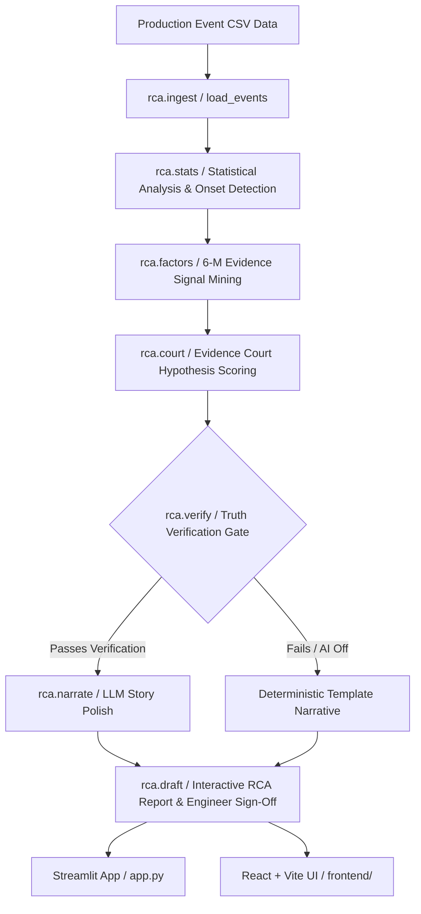

# RCA Analyzer 🔍

> **Production Incident Root Cause Analysis Engine & Interactive Intelligence Suite**

[](https://www.python.org/)
[](https://react.dev/)
[](https://vitejs.dev/)
[](https://streamlit.io/)
[](https://pytest.org/)
[](https://playwright.dev/)
[](https://www.w3.org/WAI/standards-guidelines/wcag/)

RCA Analyzer is an automated Production Root Cause Analysis system developed for manufacturing quality incident response. It ingests production event CSV time-series data, extracts correlated signals, sorts evidence into the **6-M Ishikawa framework** (*Machine, Material, Method, Measurement, People, Environment*), ranks hypothesis candidates, and enforces strict truth-verification before generating engineer-signed RCA reports.

---

## 🌟 Key Features

- **⚡ Automated Incident Detection**: Identifies onset timing, defect spikes, downtime durations, and recurring stop patterns from time-series logs.
- **🏗️ 6-M Ishikawa Categorization**: Categorizes evidence signals into Machine, Material, Method, Measurement, People, and Environment lanes.
- **⚖️ Evidence Court Hypothesis Ranking**: Evaluates candidates based on supporting vs. contradicting evidence (`Ranked`, `Cannot separate`, `Cannot determine`).
- **🛡️ Truth-Enforced LLM Verification**: Guarantees all numbers and metrics shown in natural language narrations strictly originate from computed code in `rca/` (rejects hallucinated figures).
- **✍️ Human-in-the-Loop Sign-Off**: Requires explicit engineer sign-off and decision logging before generating markdown exports.
- **🎨 Dual Frontend Interfaces**:
  - **React 19 + Vite + Tailwind Dashboard**: Modern interactive Web UI with animated timelines, event logs, evidence filtering, and detail drawers.
  - **Streamlit Desktop Application**: Clean, accessible Python app with Plotly interactive charts and WCAG AA contrast compliance.

---

## 🏛️ System Architecture



---

## 📊 Sample Incidents Included

The repository includes pre-built synthetic datasets representing standard manufacturing edge cases:

| Scenario | Name | Key Pattern | Expected Verdict |
|---|---|---|---|
| **Sample 01** | *Clear Cause* | Oven temperature exceeded 195°C for 37 min on Line 3 night shift | **Ranked** (H1 Oven Temp = 95%) |
| **Sample 02** | *Competing Causes* | Material Batch R-802 loaded & Feeder 2 speed dropped 18% simultaneously | **Cannot separate** (Confounded) |
| **Sample 03** | *Unclear Incident* | Transient defect spike auto-resolved after optical lens clean | **Cannot determine** (Insufficient evidence) |

---

## 🚀 Quick Start

### 1. Python Engine & Streamlit Application

```bash
# Clone the repository
git clone https://github.com/soujhi/RCA-Analyser.git
cd RCA-Analyser

# Create and activate Python 3.13 virtual environment
python -m venv .venv
# On Windows: .venv\Scripts\activate
# On macOS/Linux: source .venv/bin/activate

# Install Python dependencies
pip install -r requirements.txt

# Launch Streamlit Application
python -m streamlit run app.py
```
App will open locally at `http://localhost:8501`.

---

### 2. React + Vite Frontend Dashboard

```bash
# Navigate to frontend directory
cd frontend

# Install Node dependencies
npm install

# Start Vite development server
npm run dev
```
React application will open locally at `http://localhost:8443`.

---

## 🧪 Testing & Validation

The codebase maintains full test coverage with deterministic assertions:

```bash
# Run unit tests and AppTest smoke tests (70 tests)
pytest -v

# Run Playwright End-to-End browser suite (11 browser tests)
playwright install chromium
pytest -m e2e tests/e2e --override-ini addopts="" -v

# Run held-out seed validation harness
python -m validation.run_validation
```

---

## 📁 Repository Structure

```
RCA-Analyser/
├── rca/                        # Core Python Engine
│   ├── contract.py             # Data types, constants, and safety notices
│   ├── ingest.py               # CSV loader and validation report generator
│   ├── stats.py                # Time-series baseline & onset detection
│   ├── factors.py              # 6-M factor mining algorithms
│   ├── court.py                # Evidence Court ranking logic
│   ├── verify.py               # Truth verification & hallucination gate
│   ├── narrate.py              # Verified LLM story narrator
│   ├── draft.py                # RCA draft builder & engineer sign-off
│   ├── data/generator.py       # Synthetic dataset generator
│   └── ui/                     # Streamlit design tokens, components, & charts
├── frontend/                   # React 19 + Vite + Tailwind Web Application
│   ├── src/
│   │   ├── App.tsx             # Interactive 6-step RCA workspace
│   │   ├── LandingPage.tsx     # Landing page & feature showcase
│   │   ├── index.css           # Design tokens & component styling
│   │   └── landing.css         # Landing page styling
│   ├── package.json
│   └── vite.config.ts
├── tests/                      # Pytest & Playwright Test Suite
│   ├── test_court.py           # Hypothesis scoring tests
│   ├── test_verify.py          # Hallucination verifier tests
│   ├── test_tokens.py          # WCAG AA contrast compliance tests
│   └── e2e/                    # Playwright end-to-end browser tests
├── docs/                       # PRD, Architecture, and Design Docs
├── app.py                      # Streamlit application entry point
├── requirements.txt            # Python dependencies
└── README.md                   # Project documentation
```

---

## 🛡️ Safety & Disclaimer

> **Hypotheses only.** Engineering validation is required before taking any physical corrective action. This tool never controls physical manufacturing equipment directly and never declares a confirmed root cause without human engineer sign-off. All included demo data is synthetic.

---

## 📄 License

Distributed under the MIT License. See `LICENSE` for more information.
