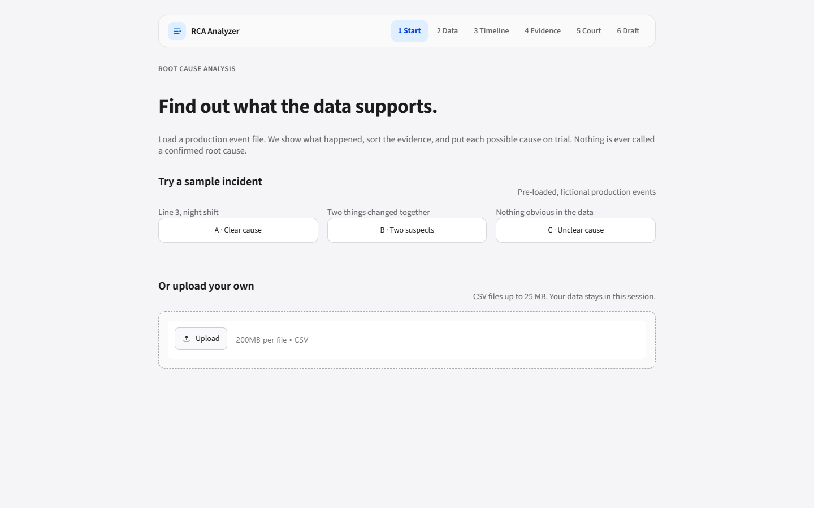
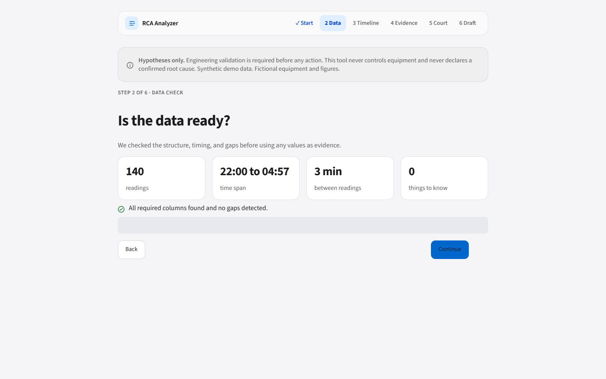
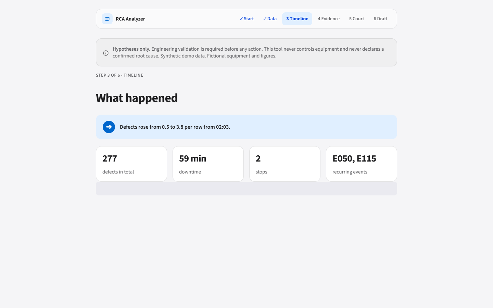
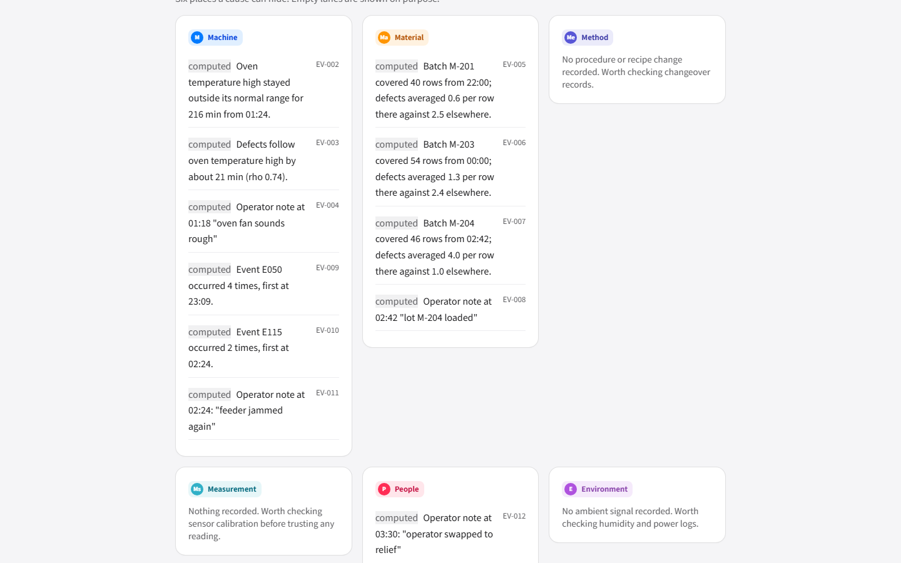
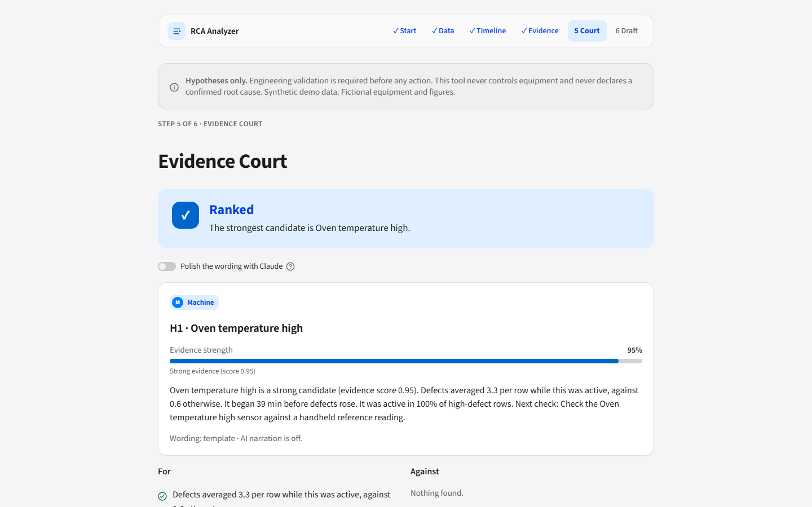
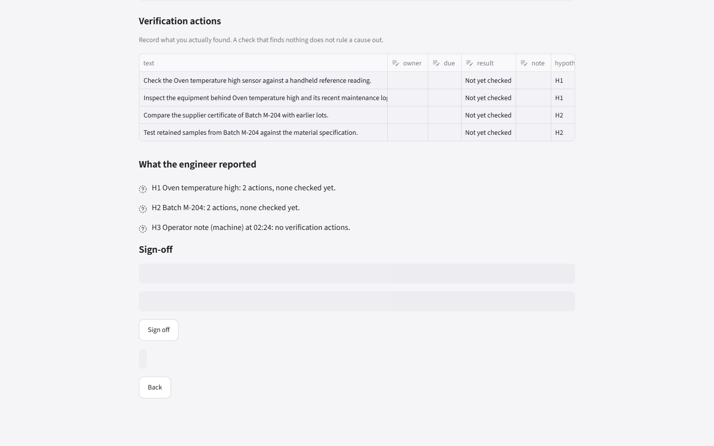

# User manual

RCA Analyzer helps you see what a production event file does and does not support. It gives hypotheses only. Engineering validation is always required.

## 1. Start
Pick a sample incident (A clear cause, B two suspects, C unclear cause) or upload your own CSV. Required columns: timestamp, line, machine, event_code, temperature, speed, defect_count, downtime_minutes, batch, operator_note.

## 2. Data
Check the four tiles and any notes about the data. Fix the file if something important is missing, then Continue.

## 3. Timeline
Read the one-sentence headline, then the chart: oven temperature, defects and downtime on one clock. The dotted line marks when defects started to rise.

## 4. Evidence
Six lanes show where evidence sits: Machine, Material, Method, Measurement, People, Environment. Every line is labelled "computed". Empty lanes say what is worth checking.

## 5. Evidence Court
The banner says Ranked, Cannot separate, or Cannot determine. Each candidate shows an evidence-strength meter, what supports it, what argues against it, and what is still unchecked. Tick an action when you have checked it. Optional: switch on AI wording; numbers always come from the analysis.

## 6. RCA draft
Edit the problem and the five whys, assign owners and due dates to the verification actions, and download the Markdown file. The draft always ends with what is not yet known.

## Reading the verdicts
- **Ranked:** one candidate stands out. It is still a hypothesis.
- **Cannot separate:** two things changed together. The data cannot tell them apart.
- **Cannot determine:** nothing is supported strongly enough. This is a valid result.
